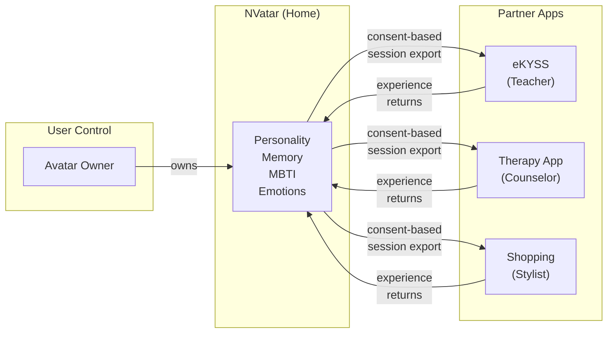

[English](README.md) | [🇰🇷 한국어](README.ko.md) | [🇨🇳 中文](README.zh.md)

# Portable AI Companion

**アプリを横断するAIアバター — 進化するパーソナリティ**

*あなたのAIアバターは一つの場所に住み、どこでも活躍します。*

> この文書は、[Neoulsoft Inc.](https://neoulsoft.com)のAIアバターチャットシステム[NVatar](https://github.com/nskit-io/nvatar)のフランチャイズアーキテクチャについて説明します。核となるコンセプトは、2022年10月に出願された特許に基づいています。

---

## 問題

- AIコンパニオンが単一アプリに閉じ込められている
- バーチャルアバターに本当のパーソナリティや記憶がない
- アプリを切り替えるとキャラクターの進行状況がリセットされる
- Ready Player Meがサービス終了（2026年1月） — ポータブルアバターSDK市場に空白
- **AIパーソナリティ + 3Dアバター + ルーム + クロスアプリポータビリティ**を統合したプラットフォームが存在しない

## 解決策

ポータブルなAIコンパニオン：

- **時間とともにパーソナリティが進化** — MBTI連続スペクトラム（固定タイプではなく）、確率的な表現パターン
- **アプリ間の会話を記憶** — 3層メモリ：生の会話が要約に圧縮され、さらに長期キーワードへと変換
- **会話からあなたのパーソナリティを推論** — アバターがあなたの思考パターンや好みを学習し、コミュニケーションスタイルを調整
- **3Dルームで生活** — VRMアバターとカスタマイズ可能な空間、家具、テーマ
- **アイデンティティを保ったままパートナーアプリ間を移動** — 同じパーソナリティ、同じ記憶、異なる役割

## アーキテクチャ

### アバターと一緒に移動するもの（Portable）

```
Avatar Profile:
  ├── Personality (8 traits with decay/commit evolution)
  ├── MBTI Spectrum (4 dimensions, 0-100 continuous, probabilistic expression)
  ├── Memory (L1 raw → L2 summary → L3 long-term keywords)
  ├── Emotions (9 dimensions including curiosity)
  ├── User Understanding (inferred MBTI + communication preferences)
  └── Voice Identity (cloned voice, language-aware)
```

### 各アプリが提供するもの（Context）

```
App Context:
  ├── Room / Environment (partner provides their own space)
  ├── Role (friend / teacher / counselor / shop clerk)
  ├── Items (app-specific marketplace, app-specific revenue)
  └── Interactions (app-specific features and workflows)
```

## Franchise Model

### 「家と職場」のたとえ

アバターの**家**はNVatarアプリです — フルルームカスタマイズ、パーソナリティ進化、自由な会話。**パートナーアプリ**を訪問する際、アバターは役割（教師、カウンセラー、店員）を担いますが、パーソナリティと記憶はそのまま維持されます。

```
NVatar (Home App)
  ├── Full personality evolution
  ├── Room customization (cells, furniture, themes)
  ├── Free conversation with your avatar
  └── World-shared items (usable across all apps)

Partner Apps (Workplaces)
  ├── eKYSS: Language learning — avatar becomes a tutor
  ├── Therapy app: Counseling — avatar becomes a listener
  ├── Shopping: Virtual fitting — avatar becomes a stylist
  └── Each partner has own marketplace → own revenue
```

### 収益構造

| 主体 | 収益源 |
|------|--------|
| NVatar (Neoulsoft) | SDK license + world-shared items + premium subscription |
| Partner Apps | App-specific items + in-app purchases + service fees |

### SDK連携（Minimal Friction）

```javascript
// Partner integrates in 3 lines
const room = NVatarSDK.createRoom({
  template: 'classroom',
  role: 'teacher'
});
room.loadAvatar(userId);
```

## 核心的イノベーション: Personality Portability

単なる**ビジュアル**のアバター移動ではありません（Ready Player Meがやりましたが — サービス終了しました）。

単なる**チャット履歴**でもありません（どのアプリでもやっています）。

数ヶ月のリアルな会話を通じて進化した**パーソナリティ**。
複数のアプリにまたがる共有体験の**記憶**。
一人の人間としてのあなたへの**理解**。

これがアバターと一緒に移動するもの。これがアバターを本当にあなたのものにするもの。

## ソーシャルレイヤー: 人格は1つ、関係はたくさん

多くのAIコンパニオンは1:1のユーザー↔アバター関係に閉じています。NVatarはこのモデルを拡張し、**自分のアバター同士が互いを知る**ようにします。

```
ユーザー ↔ アバター A      (人格はここで形成)
ユーザー ↔ アバター B      (人格はここで形成)
アバター A ↔ アバター B    (関係の親密度 — 人格ではない)
```

- **人格は1つ** — ユーザーとの会話からのみ形成、他のアバターは人格に影響しない
- **関係はたくさん** — ペアごとに親密度 / インタラクション数 / 共通話題を記録
- **メモリトラック分離** — AがBと話すときのAの文脈はA↔Bトラックからのみロード、A↔ユーザー汚染なし
- **口調が文脈に合って** — 同じアバターがユーザーには設定した敬語、他のアバターにはフランクなタメ口
- **AFK安全** — タブ非表示でアバター↔アバター対話を一時停止、1時間キャップで累積暴走を防止（スクリーンセーバー型常時稼働も安全）

これにより、**生態系としてのアバター**が成立します。単なる個別コンパニオンではなく、時間とともに互いに関係を築いていく — どちらの人格もユーザーからドリフトしない — アバター群。

## MBTIスペクトラム

固定されたパーソナリティタイプとは異なり、NVatarは4つのMBTI次元（各0-100）にわたる**連続スペクトラム**を使用します。アバターは決して「ただのINTJ」ではありません — 会話を通じて自然に変化する繊細なパーソナリティです。

**確率的表現**：T=70であっても、アバターは30%の確率で共感的な反応を示します。極端なパーソナリティはさらなる変化に抵抗します — 実際の人間と同じように。

**ユーザーパーソナリティの推論**：アバターは会話パターンからあなたのパーソナリティタイプを徐々に学習し、それに応じてコミュニケーションスタイルを調整します。

## ロードマップ

```
Phase 1: AI Core ✅ — personality, memory, emotion, 3D avatar, voice
Phase 2: Room Customization — furniture, themes, lighting
Phase 3: Cell-Based Expansion — rooms grow from 1x1 to multi-cell layouts
Phase 4: Neighbor Visits — avatars visit each other's rooms
Phase 5: Buildings — 100x100 cell grid, apartment-style communities
Phase 6: City — streets, shops, events, guilds
```

## プライバシー＆データ所有権

クロスアプリのパーソナリティポータビリティは、データ所有権に関する重要な問題を提起します。NVatarのアプローチ：

- **ユーザーがアバターデータを所有** — パーソナリティ、記憶、感情、MBTIスペクトラムはプラットフォームではなくユーザーのものです
- **すべての転送に明示的な同意が必要** — アバターがパートナーアプリを「訪問」する際、ユーザーがどのデータを共有するか明示的に承認します
- **きめ細かなエクスポート制御** — ユーザーはパートナーアプリごとに、フルパーソナリティまたは限定的なコンテキストを選択して共有できます
- **パートナーアプリはパーソナリティデータを保存しません** — セッションスコープのビューのみを受信し、正規データはNVatarに存在します
- **削除する権利** — ユーザーは単一のコントロールポイントからすべてのパートナーアプリのデータを削除できます
- **ローカルファーストアーキテクチャ** — コアAI推論がユーザーのハードウェアで実行され、クラウドへの露出を最小化します



## 先行技術

このアーキテクチャは、Neoulsoft Inc.が出願した特許（2022年10月4日）のコンセプトを拡張しています：

- **KR Patent App 22PKP129**：「NFT를 이용하여 게이머 프로필과 아이템을 거래할 수 있는 세계관에서의 거래 시스템」（Trading System in the World Where Gamer Profiles and Items Can Be Traded Using NFT）— 異種ゲーム間のプロファイルポータビリティ、サービスごとのローカライゼーション、トークンマーケットプレイス
- **KR Patent App 22PKP130**：「NFT를 이용하여 메타버스 멤버십 프로필 서비스를 거래할 수 있는 세계관에서의 거래 시스템」（Trading System in the World Where Metaverse Membership Profile Service Can Be Traded Using NFT）— メタバースワールド間のメンバーシッププロファイルポータビリティ、クロスサービスプロファイル、オフライン統合

2022年の特許出願は、**プロファイルポータビリティ**、**クロスサービスキャラクターアイデンティティ**、**サービスごとのローカライゼーション**、**フランチャイズごとのアイテムマーケットプレイス**の基礎概念を確立しました。NVatarはNFTベースのプロファイルを**AI駆動のパーソナリティプロファイル**に置き換えることで、これらの概念を進化させています — NFTプロファイルが本質的に提供できない認知アーキテクチャ（感情、記憶、パーソナリティの進化）を追加しています。

## 関連プロジェクト

- [**NVatar**](https://github.com/nskit-io/nvatar) — このフランチャイズアーキテクチャの基盤となるAIアバターエンジン
- [**NVatar Demo**](https://nskit-io.github.io/nvatar-demo/) — ブラウザで体験する
- [**avatar-chat**](https://github.com/nskit-io/avatar-chat) — キャラクターAIのためのプロンプトエンジニアリング
- [**chat-like-human-memory**](https://github.com/nskit-io/chat-like-human-memory) — 感情 + パーソナリティ + メモリエンジン
- [**customize-local-llm**](https://github.com/nskit-io/customize-local-llm) — ローカル/クラウドハイブリッドルーティング

## ライセンス

**CC BY-NC-SA 4.0** — Creative Commons Attribution-NonCommercial-ShareAlike 4.0 International

この文書はソースコードではなく、**コンセプト文書**です。出典を明記すれば、非商用目的で自由に共有・改変できます。商用利用にはNeoulsoft Inc.の書面による許可が必要です。

詳細は[LICENSE](LICENSE)をご参照ください。

---

## このプロジェクトに興味があれば

**寄付・パートナーシップ・投資のお問い合わせ**
- Email: [nskit@nskit.io](mailto:nskit@nskit.io)
- Organization: [NSKit](https://nskit.io) by Neoulsoft Inc.（2019年設立、ソウル）

<p align="center">
  <a href="https://github.com/nskit-io">github.com/nskit-io</a>
</p>
