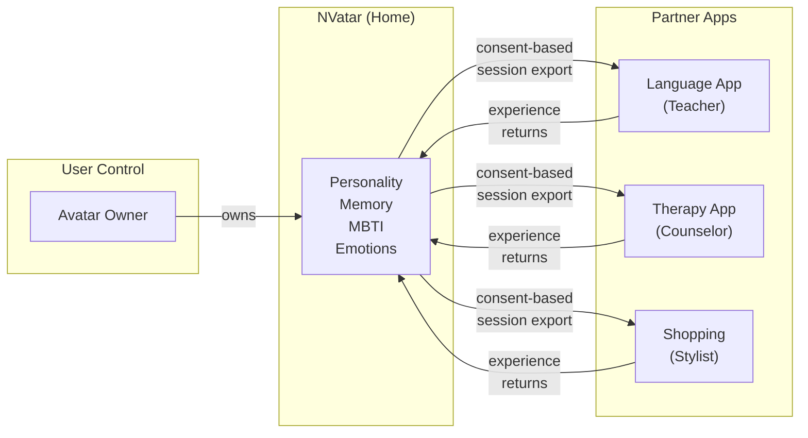

[English](README.md) | [🇯🇵 日本語](README.ja.md) | [🇨🇳 中文](README.zh.md)

# Portable AI Companion

**앱을 넘나드는 AI 아바타 — 진화하는 인격**

*당신의 AI 아바타는 한 곳에 살면서, 어디서든 활동합니다.*

> 이 문서는 [Neoulsoft Inc.](https://neoulsoft.com)의 AI 아바타 채팅 시스템 [NVatar](https://github.com/nskit-io/nvatar)를 위한 프랜차이즈 아키텍처를 설명합니다. 핵심 개념은 2022년 10월에 출원된 특허를 기반으로 합니다.

---

## 문제

- AI 컴패니언이 하나의 앱에 갇혀 있습니다
- 가상 아바타에 실제 인격이나 기억이 없습니다
- 앱을 바꾸면 캐릭터 진행 상황이 초기화됩니다
- Ready Player Me 서비스 종료 (2026년 1월) — 포터블 아바타 SDK 시장에 공백 발생
- **AI 인격 + 3D 아바타 + 룸 + 크로스앱 이동**을 모두 결합한 플랫폼은 드뭅니다

## 해결책

이동 가능한 AI 컴패니언:

- **시간이 지남에 따라 인격이 진화합니다** — MBTI 연속 스펙트럼(고정 유형이 아닌), 확률적 표현 패턴
- **앱 간 대화를 기억합니다** — 3계층 메모리: 원본 대화가 요약으로 압축되고, 이후 장기 키워드로 변환
- **대화를 통해 당신의 성격을 추론합니다** — 아바타가 당신의 사고방식과 선호를 학습하고, 커뮤니케이션 스타일을 조정합니다
- **3D 룸에서 생활합니다** — VRM 아바타와 커스터마이징 가능한 공간, 가구, 테마
- **정체성을 유지하면서 파트너 앱 간 이동합니다** — 같은 인격, 같은 기억, 다른 역할

## 아키텍처

### 아바타와 함께 이동하는 것 (Portable)

```
Avatar Profile:
  ├── Personality (8 traits with decay/commit evolution)
  ├── MBTI Spectrum (4 dimensions, 0-100 continuous, probabilistic expression)
  ├── Memory (L1 raw → L2 summary → L3 long-term keywords)
  ├── Emotions (9 dimensions including curiosity)
  ├── User Understanding (inferred MBTI + communication preferences)
  └── Voice (per-avatar selection, language-aware) ⚠️
```

> ⚠️ **음성 — 현재 상태.** 설계상으로는 아바타마다 고유한 *클론* 음성을 갖습니다.
> 이 기능이 의존하던 외부 클로닝 서비스 구독이 만료됐고, 대체 엔진이 프리빌트 음성 제공자라
> 현재는 아바타가 음성을 **소유**하는 것이 아니라 **선택**합니다.
> 언어 대응은 되어 있습니다(음성 목록과 기본값이 아바타 언어를 따릅니다).
> 아바타별 클론 음성은 현재 제공되지 않습니다.

### 각 앱이 제공하는 것 (Context)

```
App Context:
  ├── Room / Environment (partner provides their own space)
  ├── Role (friend / teacher / counselor / shop clerk)
  ├── Items (app-specific marketplace, app-specific revenue)
  └── Interactions (app-specific features and workflows)
```

## Franchise Model

### "집과 직장" 메타포

아바타의 **집**은 NVatar 앱입니다 — 풀 룸 커스터마이징, 인격 진화, 자유로운 대화. **파트너 앱**을 방문할 때, 아바타는 역할(교사, 상담사, 점원)을 맡지만 인격과 기억은 그대로 유지합니다.

```
NVatar (Home App)
  ├── Full personality evolution
  ├── Room customization (cells, furniture, themes)
  ├── Free conversation with your avatar
  └── World-shared items (usable across all apps)

Partner Apps (Workplaces)
  ├── Language-learning app: avatar becomes a tutor
  ├── Therapy app: Counseling — avatar becomes a listener
  ├── Shopping: Virtual fitting — avatar becomes a stylist
  └── Each partner has own marketplace → own revenue
```

### 수익 구조

| 주체 | 수익원 |
|------|--------|
| NVatar (Neoulsoft) | SDK license + world-shared items + premium subscription |
| Partner Apps | App-specific items + in-app purchases + service fees |

### SDK 연동 (Minimal Friction)

```javascript
// Partner integrates in 3 lines
const room = NVatarSDK.createRoom({
  template: 'classroom',
  role: 'teacher'
});
room.loadAvatar(userId);
```

## 핵심 차별점: Personality Portability

단순한 **비주얼** 아바타 이동이 아닙니다 (Ready Player Me가 했지만 — 결국 서비스를 종료했습니다).

단순한 **채팅 기록**이 아닙니다 (모든 앱이 이미 하고 있습니다).

수개월간 실제 대화를 통해 진화한 **인격**.
여러 앱에서 함께한 경험의 **기억**.
한 사람으로서 당신이 누구인지에 대한 **이해**.

이것이 아바타와 함께 이동합니다. 이것이 아바타를 진짜 당신의 것으로 만듭니다.

## 소셜 레이어: 인격은 하나, 관계는 여럿

대부분의 AI 동반자는 1:1 사용자↔아바타에 갇혀 있습니다. NVatar는 이 모델을 확장해 **내 아바타들이 서로를 알게** 합니다.

```
사용자 ↔ 아바타 A      (여기서 인격 형성)
사용자 ↔ 아바타 B      (여기서 인격 형성)
아바타 A ↔ 아바타 B    (관계 친밀도 — 인격 아님)
```

- **인격은 하나** — 사용자와의 대화로만 형성, 다른 아바타는 인격에 영향 없음
- **관계는 여럿** — 쌍별로 친밀도 / 인터랙션 수 / 공통 주제를 추적
- **메모리 트랙 분리** — A가 B와 얘기할 때 A의 맥락은 A↔B 트랙에서만 로드, A↔사용자 오염 없음
- **말투가 문맥에 맞게** — 같은 아바타가 사용자에게는 설정한 존댓말, 다른 아바타에게는 편한 평대
- **AFK 안전** — 탭 숨김 시 아바타↔아바타 대화 일시정지, 시간당 상한으로 누적 폭주 방지 (스크린세이버형 상시 구동도 안전)

이것이 **생태계로서의 아바타**를 가능하게 합니다. 단순한 개별 동반자가 아닌, 시간이 지남에 따라 서로 관계를 쌓아가는 — 어느 쪽도 사용자로부터 인격이 드리프트하지 않는 — 아바타 집단.

## MBTI 스펙트럼

고정된 성격 유형과 달리, NVatar는 4개 MBTI 차원(각 0-100)에 걸친 **연속 스펙트럼**을 사용합니다. 아바타는 절대 "그냥 INTJ"가 아닙니다 — 대화를 통해 자연스럽게 변화하는 섬세한 인격입니다.

**확률적 표현**: T=70이더라도 아바타는 30%의 확률로 감성적인 반응을 보입니다. 극단적인 성격은 추가 변화에 저항합니다 — 실제 사람처럼.

**사용자 성격 추론**: 아바타는 대화 패턴에서 당신의 성격 유형을 점진적으로 학습하고, 그에 맞게 커뮤니케이션 스타일을 조정합니다.

## 로드맵

```
Phase 1: AI Core ✅ — personality, memory, emotion, 3D avatar, voice
Phase 2: Room Customization — furniture, themes, lighting
Phase 3: Cell-Based Expansion — rooms grow from 1x1 to multi-cell layouts
Phase 4: Neighbor Visits — avatars visit each other's rooms

Long-term vision: neighborhood-scale communities and shared social spaces
```

## 프라이버시 & 데이터 소유권

크로스앱 인격 이동성은 데이터 소유권에 대한 중요한 질문을 제기합니다. NVatar의 접근 방식:

- **사용자가 아바타 데이터를 소유합니다** — 인격, 기억, 감정, MBTI 스펙트럼은 플랫폼이 아닌 사용자의 것입니다
- **모든 전송에 명시적 동의가 필요합니다** — 아바타가 파트너 앱을 "방문"할 때, 사용자가 어떤 데이터를 공유할지 명시적으로 승인합니다
- **세밀한 내보내기 제어** — 사용자는 파트너 앱별로 전체 인격 또는 제한된 컨텍스트를 선택하여 공유할 수 있습니다
- **파트너 앱은 인격 데이터를 저장하지 않습니다** — 세션 범위의 뷰만 수신하며, 정본 데이터는 NVatar에 존재합니다
- **삭제할 권리** — 사용자가 단일 제어 지점에서 모든 파트너 앱의 데이터를 삭제할 수 있습니다
- **로컬 LLM 코어** — 대화 추론은 외부 LLM API 가 아니라 운영자가 관리하는 하드웨어에서 실행되며, 클라우드 서비스는 사실 확인과 음성 합성에만 사용합니다



## 선행 기술

이 아키텍처는 Neoulsoft Inc.가 출원한 특허(2022년 10월 4일)의 개념을 확장합니다:

- **KR Patent App 22PKP129**: "NFT를 이용하여 게이머 프로필과 아이템을 거래할 수 있는 세계관에서의 거래 시스템" (Trading System in the World Where Gamer Profiles and Items Can Be Traded Using NFT) — 이종 게임 간 프로필 이동성, 서비스별 로컬라이제이션, 토큰 마켓플레이스
- **KR Patent App 22PKP130**: "NFT를 이용하여 메타버스 멤버십 프로필 서비스를 거래할 수 있는 세계관에서의 거래 시스템" (Trading System in the World Where Metaverse Membership Profile Service Can Be Traded Using NFT) — 메타버스 월드 간 멤버십 프로필 이동성, 크로스 서비스 프로필, 오프라인 통합

2022년 특허 출원은 **프로필 이동성**, **크로스 서비스 캐릭터 정체성**, **서비스별 로컬라이제이션**, **프랜차이즈별 아이템 마켓플레이스**의 기초 개념을 확립했습니다. NVatar는 NFT 기반 프로필을 **AI 기반 인격 프로필**로 대체하여 이 개념을 진화시킵니다 — NFT 프로필이 본질적으로 제공할 수 없는 인지 아키텍처(감정, 기억, 인격 진화)를 추가합니다.

## 관련 프로젝트

- [**NVatar**](https://github.com/nskit-io/nvatar) — 이 프랜차이즈 아키텍처의 기반이 되는 AI 아바타 엔진
- [**NVatar Demo**](https://nskit-io.github.io/nvatar-demo/) — 브라우저 데모 (데모 서버 점검으로 일시 중단, 소스에서 직접 실행 가능)
- [**avatar-chat**](https://github.com/nskit-io/avatar-chat) — 캐릭터 AI를 위한 프롬프트 엔지니어링
- [**chat-like-human-memory**](https://github.com/nskit-io/chat-like-human-memory) — 감정 + 인격 + 메모리 엔진
- [**customize-local-llm**](https://github.com/nskit-io/customize-local-llm) — 로컬/클라우드 하이브리드 라우팅

## 라이선스

**CC BY-NC-SA 4.0** — Creative Commons Attribution-NonCommercial-ShareAlike 4.0 International

이 문서는 소스 코드가 아닌 **개념 문서**입니다. 출처를 표시하면 비상업적 목적으로 자유롭게 공유하고 수정할 수 있습니다. 상업적 사용은 Neoulsoft Inc.의 서면 허가가 필요합니다.

자세한 내용은 [LICENSE](LICENSE)를 참조하세요.

---

## 이 프로젝트에 관심이 있다면

**후원, 파트너십 & 투자 문의**
- Email: [nskit@nskit.io](mailto:nskit@nskit.io)
- Organization: [NSKit](https://nskit.io) by Neoulsoft Inc. (2019년 설립, 서울)

<p align="center">
  <a href="https://github.com/nskit-io">github.com/nskit-io</a>
</p>
