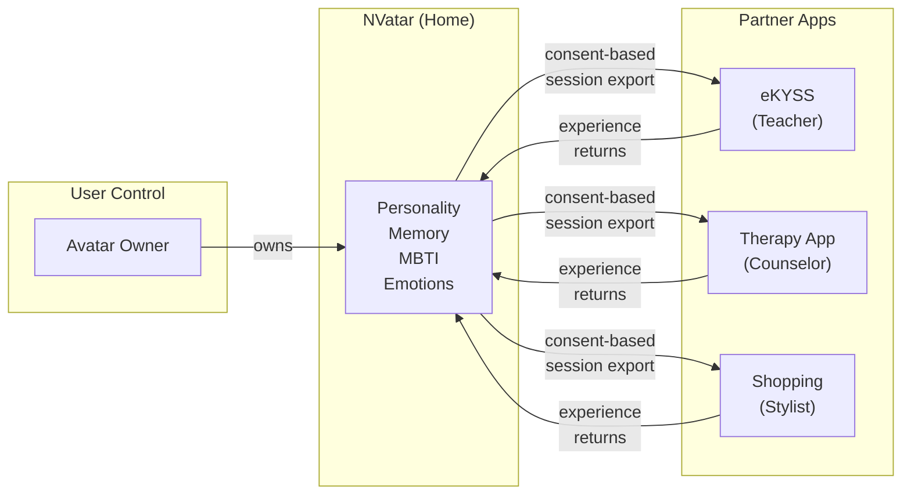

[🇰🇷 한국어](README.ko.md) | [🇯🇵 日本語](README.ja.md) | [🇨🇳 中文](README.zh.md)

# Portable AI Companion

**Cross-App Avatar with Evolving Personality**

*Your AI avatar lives in one place, works everywhere.*

> This document describes the franchise architecture for [NVatar](https://github.com/nskit-io/nvatar), an AI avatar chat system by [Neoulsoft Inc.](https://neoulsoft.com) Core concepts are based on patent applications filed in October 2022.

---

## The Problem

- AI companions are locked inside single apps
- Virtual avatars have no real personality or memory
- Character progress resets when you switch apps
- Ready Player Me shut down (Jan 2026) — the portable avatar SDK market has a vacuum
- Few platforms combine: **AI personality + 3D avatar + room + cross-app portability**

## The Solution

A portable AI companion that:

- **Evolves personality over time** — MBTI continuous spectrum (not fixed types), probabilistic expression patterns
- **Remembers conversations across apps** — 3-layer memory: raw conversations compress into summaries, then fade into long-term keywords
- **Infers YOUR personality from conversation** — The avatar learns how you think, what you prefer, and adjusts its communication style
- **Lives in a 3D room** — VRM avatar with customizable space, furniture, and themes
- **Moves between partner apps while keeping identity** — Same personality, same memories, different roles

## Architecture

### What Travels With Your Avatar (Portable)

```
Avatar Profile:
  ├── Personality (8 traits with decay/commit evolution)
  ├── MBTI Spectrum (4 dimensions, 0-100 continuous, probabilistic expression)
  ├── Memory (L1 raw → L2 summary → L3 long-term keywords)
  ├── Emotions (9 dimensions including curiosity)
  ├── User Understanding (inferred MBTI + communication preferences)
  └── Voice (per-avatar selection, language-aware) ⚠️
```

> ⚠️ **Voice — current status.** The design calls for a *cloned* voice unique to each avatar.
> The external cloning service this depended on lapsed, and the replacement engine is a
> prebuilt-voice provider, so today an avatar **selects** a voice rather than **owning** one.
> Language-awareness is in place (the voice list and default follow the avatar's language).
> Per-avatar cloned identity is not currently shipped.

### What Each App Provides (Context)

```
App Context:
  ├── Room / Environment (partner provides their own space)
  ├── Role (friend / teacher / counselor / shop clerk)
  ├── Items (app-specific marketplace, app-specific revenue)
  └── Interactions (app-specific features and workflows)
```

## Franchise Model

### The "Home and Workplace" Metaphor

Your avatar's **home** is the NVatar app — full room customization, personality evolution, free conversation. When visiting **partner apps**, the avatar takes on a role (teacher, counselor, clerk) but keeps its personality and memories intact.

```
NVatar (Home App)
  ├── Full personality evolution
  ├── Room customization (cells, furniture, themes)
  ├── Free conversation with your avatar
  └── World-shared items (usable across all apps)

Partner Apps (Workplaces)
  ├── eKYSS: Language learning — avatar becomes a tutor
  ├── Therapy app: Counseling — avatar becomes a listener
  ├── Shopping: Virtual fitting — avatar becomes a stylist
  └── Each partner has own marketplace → own revenue
```

### Revenue Structure

| Entity | Revenue Source |
|--------|--------------|
| NVatar (Neoulsoft) | SDK license + world-shared items + premium subscription |
| Partner Apps | App-specific items + in-app purchases + service fees |

### SDK Integration (Minimal Friction)

```javascript
// Partner integrates in 3 lines
const room = NVatarSDK.createRoom({
  template: 'classroom',
  role: 'teacher'
});
room.loadAvatar(userId);
```

## The Key Difference: Personality Portability

Not just **visual** avatar portability (Ready Player Me did that — and shut down).

Not just **chat history** (every app does that).

**PERSONALITY** that evolved over months of real conversation.
**MEMORY** of shared experiences across multiple apps.
**UNDERSTANDING** of who you are as a person.

This is what moves with your avatar. This is what makes it yours.

## Social Layer: One Personality, Many Relationships

Most AI companions are locked to 1:1 user↔avatar dyads. NVatar extends the model so **your avatars know each other**.

```
User ↔ Avatar A     (personality forms here)
User ↔ Avatar B     (personality forms here)
Avatar A ↔ Avatar B (relationship intimacy — not personality)
```

- **Personality is singular** — shaped only by the user, never by other avatars.
- **Relationships are many** — each pair tracks its own intimacy, interaction count, shared topics.
- **Memory is track-scoped** — when A talks to B, A's conversation context is pulled from the A↔B track, not from A↔User. No cross-pollution.
- **Speech adapts contextually** — same avatar uses your configured politeness with you, casual peer tone with other avatars.
- **AFK-safe** — tab-hidden pauses avatar↔avatar dialogues; hourly cap prevents runaway accumulation. Safe for screensaver-style always-on scenarios.

This is what makes **avatars as an ecosystem** possible, not just individual companions. Your avatars develop relationships with each other over time — without either's personality drifting from you.

## The MBTI Spectrum

Unlike fixed personality types, NVatar uses a **continuous spectrum** across 4 MBTI dimensions (0-100 each). Your avatar is never "just an INTJ" — it's a nuanced personality that shifts naturally through conversation.

**Probabilistic expression**: Even at T=70, the avatar shows empathetic responses 30% of the time. Extreme personalities resist further change — like real people.

**User personality inference**: The avatar gradually learns YOUR personality type from conversation patterns and adjusts its communication style accordingly.

## Growth Path

```
Phase 1: AI Core ✅ — personality, memory, emotion, 3D avatar, voice
Phase 1.5: SDK Architecture ✅ — BehaviorPattern Registry, Franchise Memory, God Mode
  ├── BehaviorPattern Registry ✅ — pluggable behavior system (relay/assisted/pure_chat)
  ├── Franchise Memory 3-Track ✅ — Core + Franchise + User Profile separation
  ├── God Mode ✅ — context_router + user_profiler (blind analysis)
  ├── Identity Preservation ✅ — domain work doesn't change personality
  ├── Code Assist (first pattern) ✅ — Claude Code relay via MCP channel
  └── eKYSS partner integration 🔲 — designed, implementation pending
Phase 2: Room Customization — furniture, themes, lighting
Phase 3: Cell-Based Expansion — rooms grow from 1x1 to multi-cell layouts
Phase 4: Neighbor Visits — avatars visit each other's rooms

Long-term vision: neighborhood-scale communities and shared social spaces
```

## Privacy & Data Ownership

Cross-app personality portability raises critical questions about data ownership. NVatar's approach:

- **User owns their avatar data** — personality, memory, emotions, and MBTI spectrum belong to the user, not the platform
- **Explicit consent for every transfer** — when an avatar "visits" a partner app, the user explicitly approves what data is shared
- **Granular export control** — users can choose to share full personality or limited context per partner app
- **Partner apps never store personality data** — they receive a session-scoped view, the canonical data lives in NVatar
- **Right to delete** — user can wipe all data across all partner apps from a single control point
- **Local-first architecture** — core AI inference runs on user's hardware, minimizing cloud exposure



## Prior Art

This architecture extends concepts from patent applications filed by Neoulsoft Inc. (October 4, 2022):

- **KR Patent App 22PKP129**: "Trading System in the World Where Gamer Profiles and Items Can Be Traded Using NFT" — Profile portability across heterogeneous games, localization per service, token marketplace
- **KR Patent App 22PKP130**: "Trading System in the World Where Metaverse Membership Profile Service Can Be Traded Using NFT" — Membership profile portability across metaverse worlds, cross-service profiles, offline integration

The 2022 patent applications established the foundational concepts of **profile portability**, **cross-service character identity**, **per-service localization**, and **item marketplace per franchise**. NVatar evolves these concepts by replacing NFT-based profiles with **AI-driven personality profiles** — adding cognitive architecture (emotion, memory, personality evolution) that NFT profiles inherently cannot provide.

## Related Projects

- [**NVatar**](https://github.com/nskit-io/nvatar) — The AI avatar engine this franchise architecture is built on
- [**NVatar SDK**](https://github.com/nskit-io/nvatar-sdk) — SDK guide for building custom BehaviorPatterns (MIT)
- [**NVatar Code Assist**](https://github.com/nskit-io/nvatar-code-assist) — Claude Code integration (first SDK pattern implementation)
- [**NVatar Demo**](https://nskit-io.github.io/nvatar-demo/) — Try it in your browser
- [**avatar-chat**](https://github.com/nskit-io/avatar-chat) — Prompt engineering for character AI
- [**chat-like-human-memory**](https://github.com/nskit-io/chat-like-human-memory) — Emotion + personality + memory engine
- [**customize-local-llm**](https://github.com/nskit-io/customize-local-llm) — Local/cloud hybrid routing

## License

**CC BY-NC-SA 4.0** — Creative Commons Attribution-NonCommercial-ShareAlike 4.0 International

This is a **concept document**, not source code. You may share and adapt this material for non-commercial purposes with attribution. Commercial use requires written permission from Neoulsoft Inc.

See [LICENSE](LICENSE) for details.

---

## Interested?

**Donation, Partnership & Investment Inquiry**
- Email: [nskit@nskit.io](mailto:nskit@nskit.io)
- Organization: [NSKit](https://nskit.io) by Neoulsoft Inc. (est. 2019, Seoul)

<p align="center">
  <a href="https://github.com/nskit-io">github.com/nskit-io</a>
</p>
