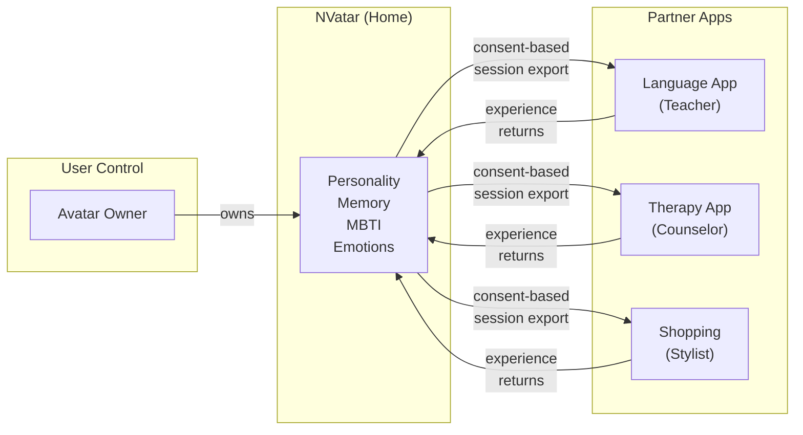

[English](README.md) | [🇰🇷 한국어](README.ko.md) | [🇯🇵 日本語](README.ja.md)

# Portable AI Companion

**跨应用AI虚拟形象 — 不断进化的人格**

*你的AI虚拟形象住在一个地方，在任何地方都能工作。*

> 本文档描述了[NVatar](https://github.com/nskit-io/nvatar)的Franchise 架构，NVatar是[Neoulsoft Inc.](https://neoulsoft.com)开发的AI虚拟形象聊天系统。核心概念基于2022年10月提交的专利申请。

---

## 问题

- AI伴侣被锁定在单个应用中
- 虚拟形象没有真正的人格或记忆
- 切换应用时角色进度被重置
- Ready Player Me停止服务（2026年1月） — 便携式头像SDK市场出现真空
- 很少有平台能同时结合：**AI人格 + 3D虚拟形象 + 房间 + 跨应用可移植性**

## 解决方案

一个可移植的AI伴侣：

- **人格随时间进化** — MBTI连续光谱（非固定类型）、概率性表达模式
- **跨应用记忆对话** — 三层记忆：原始对话压缩为摘要，再转化为长期关键词
- **从对话中推断你的性格** — 虚拟形象学习你的思维方式和偏好，并调整沟通风格
- **生活在3D房间中** — VRM虚拟形象，可自定义空间、家具和主题
- **在合作伙伴应用间移动，同时保持身份** — 相同的人格，相同的记忆，不同的角色

## 架构

### 与虚拟形象一起移动的内容（Portable）

```
Avatar Profile:
  ├── Personality (8 traits with decay/commit evolution)
  ├── MBTI Spectrum (4 dimensions, 0-100 continuous, probabilistic expression)
  ├── Memory (L1 raw → L2 summary → L3 long-term keywords)
  ├── Emotions (9 dimensions including curiosity)
  ├── User Understanding (inferred MBTI + communication preferences)
  └── Voice (per-avatar selection, language-aware) ⚠️
```

> ⚠️ **语音 — 当前状态。** 设计上每个虚拟形象拥有独有的*克隆*语音。
> 此功能依赖的外部克隆服务已到期，替代引擎为预置语音提供方，
> 因此目前虚拟形象是**选择**语音，而非**拥有**语音。
> 语言适配已就位（语音列表与默认值跟随虚拟形象的语言）。
> 按虚拟形象克隆的语音目前尚未提供。

### 每个应用提供的内容（Context）

```
App Context:
  ├── Room / Environment (partner provides their own space)
  ├── Role (friend / teacher / counselor / shop clerk)
  ├── Items (app-specific marketplace, app-specific revenue)
  └── Interactions (app-specific features and workflows)
```

## Franchise Model

### "家与职场"的比喻

虚拟形象的**家**是NVatar应用 — 完整的房间自定义、人格进化、自由对话。访问**合作伙伴应用**时，虚拟形象会担任角色（教师、咨询师、店员），但人格和记忆保持不变。

```
NVatar (Home App)
  ├── Full personality evolution
  ├── Room customization (cells, furniture, themes)
  ├── Free conversation with your avatar
  └── World-shared items (usable across all apps)

Partner Apps (Workplaces)
  ├── Language-learning app: avatar becomes a tutor
  ├── Therapy app: Counseling — avatar becomes a listener
  ├── Shopping: Virtual fitting — avatar becomes a stylist
  └── Each partner has own marketplace → own revenue
```

### 收入结构

| 主体 | 收入来源 |
|------|----------|
| NVatar (Neoulsoft Inc.) | SDK license + world-shared items + premium subscription |
| Partner Apps | App-specific items + in-app purchases + service fees |

### SDK集成（Minimal Friction）

```javascript
// Partner integrates in 3 lines
const room = NVatarSDK.createRoom({
  template: 'classroom',
  role: 'teacher'
});
room.loadAvatar(userId);
```

## 核心差异：Personality Portability

不只是**视觉**上的虚拟形象移植（Ready Player Me做过 — 后来关停了）。

不只是**聊天记录**（所有应用都在做）。

经过数月真实对话进化而来的**人格**。
跨多个应用的共同经历形成的**记忆**。
对你这个人的深层**理解**。

这些才是随虚拟形象一起移动的东西。这才是让它真正属于你的原因。

## 社交层：人格唯一，关系丰富

大多数AI伴侣都被锁定在1:1的用户↔虚拟形象关系中。NVatar扩展了这一模型，让**你的多个虚拟形象彼此相识**。

```
用户 ↔ 虚拟形象 A          (人格在此形成)
用户 ↔ 虚拟形象 B          (人格在此形成)
虚拟形象 A ↔ 虚拟形象 B    (关系亲密度 — 不是人格)
```

- **人格唯一** — 仅由与用户的对话塑造，其他虚拟形象不影响人格
- **关系丰富** — 每对虚拟形象独立记录亲密度 / 互动次数 / 共同话题
- **记忆轨道分离** — A和B对话时，A的上下文仅从A↔B轨道加载，不污染A↔用户轨道
- **语气随语境自适应** — 同一虚拟形象对用户使用配置的敬语，对其他虚拟形象使用平等随意的语气
- **AFK安全** — 标签页隐藏时虚拟形象↔虚拟形象对话暂停，每小时上限防止累积失控（屏保式常驻场景也安全)

这使得**作为生态系统的虚拟形象**成为可能。不再是孤立的单个伴侣，而是随时间推移彼此建立关系 — 任一方的人格都不会偏离用户 — 的虚拟形象群体。

## MBTI光谱

与固定的性格类型不同，NVatar使用跨4个MBTI维度（各0-100）的**连续光谱**。你的虚拟形象绝不只是"一个INTJ" — 它是一个通过对话自然变化的细腻人格。

**概率性表达**：即使T=70，虚拟形象也会以30%的概率展现共情反应。极端的性格会抵抗进一步变化 — 就像真实的人一样。

**用户性格推断**：虚拟形象会从对话模式中逐步学习你的性格类型，并相应调整沟通风格。

## 发展路线

```
Phase 1: AI Core ✅ — personality, memory, emotion, 3D avatar, voice
Phase 2: Room Customization — furniture, themes, lighting
Phase 3: Cell-Based Expansion — rooms grow from 1x1 to multi-cell layouts
Phase 4: Neighbor Visits — avatars visit each other's rooms

Long-term vision: neighborhood-scale communities and shared social spaces
```

## 隐私与数据所有权

跨应用人格可移植性引发了关于数据所有权的关键问题。NVatar的方案：

- **用户拥有自己的虚拟形象数据** — 人格、记忆、情感和MBTI光谱属于用户，而非平台
- **每次传输都需要明确同意** — 当虚拟形象"访问"合作伙伴应用时，用户明确批准共享哪些数据
- **精细的导出控制** — 用户可以选择按合作伙伴应用共享完整人格或有限的上下文
- **合作伙伴应用不存储人格数据** — 它们仅接收会话范围的视图，权威数据保留在NVatar中
- **删除权** — 用户可以从单一控制点清除所有合作伙伴应用中的数据
- **本地LLM核心** — 对话推理在运营方管理的硬件上运行，而非第三方LLM API；云服务仅用于事实查询和语音合成



## 先行技术

本架构扩展了Neoulsoft Inc.提交的专利申请（2022年10月4日）中的概念：

- **KR Patent App 22PKP129**："NFT를 이용하여 게이머 프로필과 아이템을 거래할 수 있는 세계관에서의 거래 시스템"（Trading System in the World Where Gamer Profiles and Items Can Be Traded Using NFT）— 异构游戏间的档案可移植性、按服务本地化、代币市场
- **KR Patent App 22PKP130**："NFT를 이용하여 메타버스 멤버십 프로필 서비스를 거래할 수 있는 세계관에서의 거래 시스템"（Trading System in the World Where Metaverse Membership Profile Service Can Be Traded Using NFT）— 元宇宙世界间的会员档案可移植性、跨服务档案、线下集成

2022年的专利申请确立了**Profile可移植性**、**跨服务角色身份**、**按服务本地化**和**Franchise级道具市场**的基础概念。NVatar将基于NFT的Profile替换为**AI驱动的人格Profile** — 增加了NFT Profile本质上无法提供的认知架构（情感、记忆、人格进化）。

## 相关项目

- [**NVatar**](https://github.com/nskit-io/nvatar) — 本Franchise 架构所基于的AI虚拟形象引擎
- [**NVatar Demo**](https://nskit-io.github.io/nvatar-demo/) — 浏览器演示（演示服务器维护中，暂时下线；仍可从源码运行）
- [**avatar-chat**](https://github.com/nskit-io/avatar-chat) — 角色AI的Prompt工程
- [**chat-like-human-memory**](https://github.com/nskit-io/chat-like-human-memory) — 情感 + 人格 + 记忆引擎
- [**customize-local-llm**](https://github.com/nskit-io/customize-local-llm) — 本地/云端混合路由

## 许可证

**CC BY-NC-SA 4.0** — Creative Commons Attribution-NonCommercial-ShareAlike 4.0 International

本文档是**概念文档**，而非源代码。注明出处即可出于非商业目的自由分享和改编。商业使用需获得Neoulsoft Inc.的书面许可。

详情请参阅[LICENSE](LICENSE)。

---

## 对这个项目感兴趣？

**捐赠、合作与投资咨询**
- Email: [nskit@nskit.io](mailto:nskit@nskit.io)
- Organization: [NSKit](https://nskit.io) by Neoulsoft Inc.（2019年成立，首尔）

<p align="center">
  <a href="https://github.com/nskit-io">github.com/nskit-io</a>
</p>
